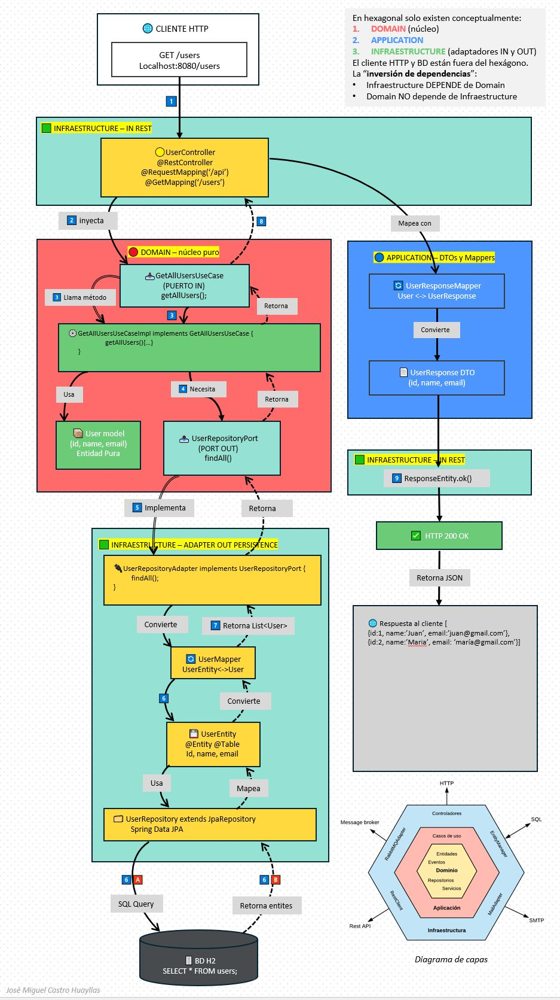
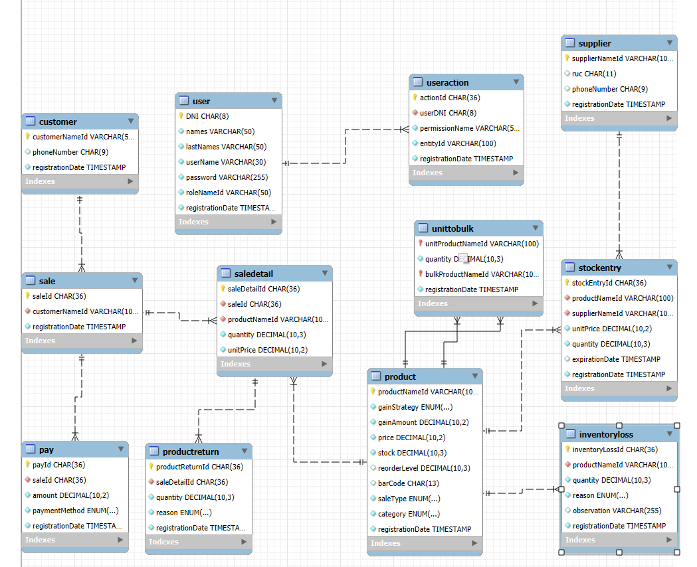

<p align="center">
  <a href="https://github.com/Nakusuo"></a>
</p>

# Minerva

Minerva es el backend de un sistema para una **tienda o minimarket**: lleva los productos y su stock, registra las ventas y los pagos, y guarda clientes y proveedores. Lo hicimos para el curso de **Lenguajes de Programación**, y el objetivo era aprender a construir una API ordenada con **arquitectura hexagonal**.

> El nombre del repo dice "Frontend" por cómo se organizó la entrega, pero lo que hay aquí es la API REST en Spring Boot.

## La idea: arquitectura hexagonal

El corazón del sistema (las reglas del negocio) no sabe nada de Spring, de la base de datos ni de HTTP. Todo eso vive afuera, en "adaptadores" que se conectan al núcleo a través de puertos. Así se puede cambiar la base de datos o la forma de exponer la API sin tocar la lógica de la tienda.

<p align="center">
  
</p>

```text
minerva/src/main/java/com/minerva/
├── domain/          # el núcleo: entidades, reglas, excepciones y repositorios (interfaces)
├── application/     # casos de uso y servicios que los coordinan
└── infrastructure/  # adaptadores: controladores REST, JPA, seguridad con JWT
```

## Qué resuelve

- **Productos e inventario**: alta de productos con código de barras y categoría, entradas de stock por proveedor (con fecha de vencimiento), mermas y equivalencias entre unidad y granel (por ejemplo, un saco de arroz y su venta por kilo).
- **Precios**: cada producto calcula su precio con una ganancia **porcentual** o **incremental**.
- **Ventas y pagos**: una venta tiene su detalle, puede pagarse en partes, en **efectivo** o **digital**, y admite devoluciones.
- **Clientes y proveedores**, con búsqueda por teléfono o RUC.
- **Usuarios con roles**: `ADMIN`, `VENDEDOR` y `ALMACENISTA`, cada uno con sus permisos. Las acciones quedan registradas.

## La base de datos

<p align="center">
  
</p>

Los scripts están en [`SQL/`](SQL/): `apolo.sql` para MySQL y `postgress.sql` para PostgreSQL.

## Con qué está hecho

Java 25, Spring Boot 4, Spring Data JPA, Spring Security con JWT, Bean Validation, Lombok y MySQL.

## Cómo correrlo

Necesitas JDK 25 y MySQL.

1. Crea la base de datos con `SQL/apolo.sql` (se llama `apolo`).
2. Revisa usuario y contraseña de MySQL en `minerva/src/main/resources/application.yaml`.
3. Arranca la API:
   ```bash
   cd minerva
   ./mvnw spring-boot:run
   ```

Queda en `http://localhost:8080`. Primero registra un usuario o inicia sesión en `/api/v1/auth`, y usa el token en el resto de rutas.

<details>
<summary>Endpoints</summary>

| Recurso | Rutas |
|---|---|
| Auth | `POST /api/v1/auth/login`, `POST /api/v1/auth/register` |
| Productos | `POST /api/v1/products`, `GET /api/v1/products`, `GET /api/v1/products/{id}`, `GET /api/v1/products/barcode/{barCode}`, `POST /api/v1/products/{id}/stock-entries`, `POST /api/v1/products/unit-to-bulk` |
| Ventas | `POST /api/v1/sales`, `GET /api/v1/sales`, `GET /api/v1/sales/{id}`, `GET /api/v1/sales/customer/{customerId}`, `POST /api/v1/sales/{id}/payments` |
| Clientes | `POST /api/v1/customers`, `GET /api/v1/customers`, `GET /api/v1/customers/{id}`, `GET /api/v1/customers/search`, `PATCH /api/v1/customers/{id}/phone-number` |
| Proveedores | `POST /api/v1/suppliers`, `GET /api/v1/suppliers`, `GET /api/v1/suppliers/{name}`, `GET /api/v1/suppliers/ruc/{ruc}`, `GET /api/v1/suppliers/phone/{phone}`, `PATCH /api/v1/suppliers/{name}/phone-number`, `PATCH /api/v1/suppliers/{name}/ruc` |

</details>
